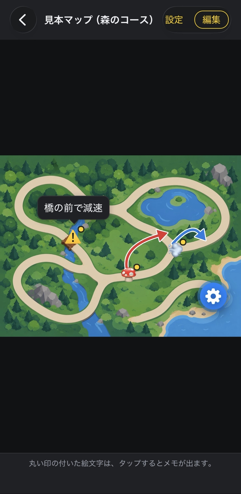

# トレイルマーカー (Trail Marker) — 設計とテストの紹介

マップの画像に、絵文字・矢印・メモを書き込んで、自分だけのマップを作れる iPhone アプリ「トレイルマーカー」です。
このリポジトリは、アプリの **設計と、端末の機能を使わない計算・規則の部分（テスト付き）** を紹介するためのものです。アプリ本体は、非公開のリポジトリで開発しています。

> A mobile app (Expo / React Native, JavaScript) for annotating your own map images with emoji, arrows and notes. This repository shows the app's design and its pure-logic modules with tests. The full app source is in a private repository.

状態: 開発中（最初のリリースは、日本の App Store の予定）。サポートページ: https://trail-marker.pages.dev/

<!--
📷 写真を貼る場所 1（アプリ全体）
  画面写真を docs/images/01-list.png として保存して、この囲み（コメント）を外して、下の画像の行だけを残す。
  
-->

## アプリでできること

- マップの画像を取り込み、名前を付けて保存。名前で検索（ひらがな・カタカナ、全角・半角を区別しない）
- 絵文字を置く・動かす・大きさを変える。矢印を指でなぞって引き、曲げたり、色・太さを変えたりできる
- 絵文字にメモを付ける。見るだけの「表示」では、タップすると吹き出しで読める
- フォルダ（二段まで）、2枚を並べて見る「組み合わせ」、同じフォルダのマップの切り替え
- 一覧のアイコン（絵文字・写真）、背景の色・写真、ボタンの色を、好きに変えられる
- フォルダやマップを、ファイル（`.trailmarker`）にして共有・読み込み。サーバーは使わない



<!--
📷 写真を貼る場所 2（書き込み）
  docs/images/02-edit.png（絵文字と矢印を置いた編集の画面）
  
-->

## 技術

| | |
|---|---|
| 言語・基盤 | JavaScript、Expo SDK 57、React Native 0.86、Expo Router |
| データ | expo-sqlite（バージョン管理つきのマイグレーション）、画像はファイルとして保存 |
| 描画 | react-native-svg（矢印）、自前のジェスチャー（ドラッグ・タップ） |
| 共有ファイル | jszip（zip）。中身は JSON と画像 |
| テスト | Node.js 標準のテスト（`node --test`）。アプリ本体では 128 件 |
| 個人情報 | サーバー、アカウント、解析は無し。データは端末の中だけ |

## テストを動かす

このリポジトリの計算と規則の部分は、アプリ本体と切り離して、単独で動きます。

```
npm install
npm test
```

## このリポジトリにあるもの

```
src/lib/   端末の機能を使わない、計算・規則・検査と、そのテスト
src/db/    データベースのマイグレーション（バージョン管理）
docs/      写真を置く場所
```

画面、データベースの読み書き、ファイルの入出力など、アプリ本体のコードは含みません。

## 権利について

Copyright (c) 2026 Torihara-R. All rights reserved.

このリポジトリのソースコードは、閲覧・評価の目的で公開しています。許可なく、複製・再配布・改変・ストアへの公開をすることは、できません。
